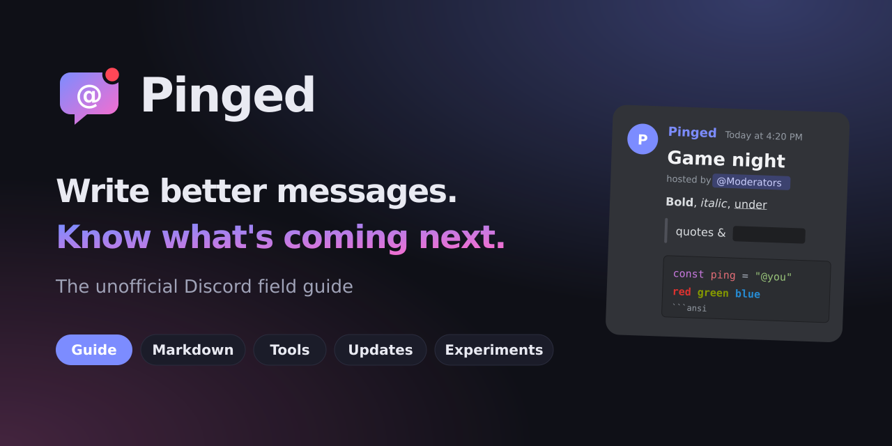

<p align="center">
  
</p>

# Pinged

**The unofficial Discord field guide.** Every markdown trick with a live Discord-style preview, tips that save clicks, the latest Discord updates, and the experiments Discord is testing.

## Tabs

| Tab | What's in it |
| --- | --- |
| **Guide** | Quick wins, keyboard shortcuts, quick-switcher prefixes, search filters, chat tricks |
| **Markdown** | Every format (text, headers, subtext, lists, quotes, code, ANSI colour, spoilers, links, mentions, timestamps) with a live preview. **Try it** opens any example in the playground |
| **Tools** | Live playground (explains why a message won't format, starts from templates, copies a link to your message), embed builder (up to ten embeds per message, preview, Discord's limits, import JSON, copy as JSON, curl, JavaScript or Python, or send to your webhook), message splitter (cuts a long message to fit 2000 or 4000 characters without breaking code blocks, bold or spoilers), permissions calculator with a bot invite link, ID decoder, timestamp maker, coloured-text (ANSI) builder |
| **Updates** | Discord changelogs and patch notes, newest first, with the source's own image and links |
| **Experiments** | Write-ups of features being tested, filtered by status or kind, plus a live feed of experiments added or removed in each Discord app update |
| **Status** | Live Discord status: systems, open incidents, maintenance and past incidents |
| **Sources** | Official Discord channels, experiment trackers and community sites |

Also: search (press `/`), a `#` link on every entry for sharing, "New" markers since your last visit, an RSS feed (`feed.xml`), a printable Markdown cheat sheet (`#/cheatsheet`, linked from the Markdown tab), **Save image** on the playground and embed previews (PNG), and **Copy link** on the embed builder, which reopens the builder with your message filled in. A shared link's pictures are held back until the visitor clicks **Show pictures**, because loading them tells the picture's host the page was opened.

**Offline and installable.** After one visit the guide loads without a connection, and browsers that support it offer to install it as an app. Status and the experiment feed still need the network. Online, you always get the latest files; offline, the saved copy. If you change the list of files in `sw.js`, bump its `VERSION`.

Save image draws the preview in your browser. Pictures hosted on other sites are included only when that site allows it; the page says when some were left out.

## Live data

- **Status** comes from Discord's official status page API (`discordstatus.com/api/v2`).
- **Experiment feed** comes from comments on [Discord-Datamining](https://github.com/Discord-Datamining/Discord-Datamining) through GitHub's public API. Visitors' browsers cache it for 15 minutes to stay under GitHub's limit of 60 requests an hour.

Nothing needs a server or API key.

## Run it

No build step. It's plain HTML, CSS and JavaScript.

```bash
python3 -m http.server 8000
# open http://localhost:8000
```

Deploys as-is to Vercel, Netlify or GitHub Pages. Light and dark themes follow your system, with a switch in the top-right corner.

## Edit content

All guide text, updates, experiments and sources live in [`js/content.js`](js/content.js). Add an entry and refresh. Keep a source on every update and experiment.

After editing content, rebuild the RSS feed (the tests fail if you forget):

```bash
node scripts/build-feed.js
# or, if the site lives somewhere other than https://retroul.github.io/Pinged/:
SITE_URL=https://your-site.example/ node scripts/build-feed.js
```

## Keeping content fresh

The Updates and Experiments pages are written by hand from the sources on the Sources page. After you've checked them, update `js/content.js`, bump `lastChecked` there, and run `node scripts/build-feed.js`. The weekly workflow fails (and GitHub emails you) when `lastChecked` is more than 14 days old.

## Tests

```bash
node --test test/
```

## Files

```
index.html            page shell and tabs
sw.js                 offline cache
manifest.webmanifest  install details for browsers
css/style.css         styles (site + Discord-style chat previews)
css/fonts.css         self-hosted Bricolage Grotesque (assets/fonts/)
js/markdown.js        Discord markdown → safe HTML renderer, plus the message checker
js/content.js         all site content, including playground templates
js/live.js            live Discord status and experiment feed
js/embed.js           embed builder (limits, JSON import, share links, code export, preview, webhook send)
js/snapshot.js        saves a preview as a PNG
js/discord.js         permission flags, invite links, ID decoding
js/app.js             tabs, pages, search, tools, theme switch
scripts/build-feed.js builds feed.xml from content, and writes the site address into index.html
scripts/check-fresh.js fails if the content hasn't been re-checked in 14 days
.github/workflows/ci.yml runs the tests on every push, and the freshness check every Monday
feed.xml              RSS feed
assets/               logo, app icons and GitHub social preview (SVG + PNG)
test/                 tests
```

## GitHub social preview

Upload `assets/social-preview.png` (1280×640) in your repo under **Settings → General → Social preview**.

## License

MIT, see [LICENSE](LICENSE). The license covers Pinged's code and writing, not the images loaded from other sites or Discord's names and logos. Bricolage Grotesque is used under the SIL Open Font License.

---

Pinged is a fan project and is not affiliated with or endorsed by Discord Inc. Images on the Updates and Experiments pages are loaded from, and belong to, the sites credited under them.
